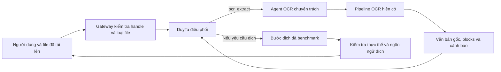

# DuyTa gọi agent OCR chuyên trách — thiết kế đề xuất

Ngày 2026-10-04. Người dùng đã duyệt thiết kế bằng “oke”; implementation plan được ghi riêng tại `ocr-specialist-implementation.md`. Người dùng đề xuất tách OCR chuyên trách và để DuyTa gọi khi có tác vụ liên quan; đồng thời xác nhận DuyTa được huấn luyện nhiều cho điều phối. Đây là thiết kế dựa trên code hiện có, chưa phải chức năng đã triển khai. Benchmark dịch đang tiếp tục; theo lựa chọn mới nhất của người dùng, không gọi model hoặc nạp model mới khi lượt OCR hiện hành chưa hoàn tất.

## Quyết định đề xuất

Giữ DuyTa làm bộ điều phối. Agent OCR là một worker có phạm vi rõ, được cung cấp cho DuyTa qua tool có schema và kết quả cấu trúc. Tái sử dụng pipeline của task file/OCR, không tạo một OCR backend thứ hai hoặc thêm vòng lập kế hoạch bằng LLM trong worker.

OCR và dịch là hai năng lực riêng. OCR biến ảnh thành văn bản; bước dịch xử lý văn bản đó. Agent OCR vẫn hữu ích ngay cả khi DuyTa đạt benchmark dịch. Nếu DuyTa không đạt chất lượng dịch, so sánh model chuyên dịch theo quyền người dùng đã cấp; việc chọn/triển khai model dịch là quyết định riêng, không gán OCR là cách khắc phục chất lượng dịch.

Luồng đề xuất:

File có lớp chữ dùng extractor sẵn có; ảnh dùng OCR. PDF scan chỉ được đưa vào OCR sau khi owner file hỗ trợ rasterization/pages trong contract; không tuyên bố pipeline ảnh hiện tại đã xử lý PDF scan hoặc layout đầy đủ.

## Điểm tái sử dụng đã kiểm tra

- Nhánh OCR `ff311c1`: `translation/types.py` định nghĩa `OcrPipeline.process`, `CorrectedOcr`, `DocumentBlock`, `WarningItem`; `ImageOcrPipeline` là implementation của owner OCR.
- `CorrectedOcr` có `raw_text`, `corrected_text`, `edits`, `warnings`, `needs_review`. Không có trường confidence/bounding-box bắt buộc; lớp tool chỉ trả những metadata backend thực sự cung cấp, không bịa độ tin cậy hay tọa độ.
- Contract v2 quy định OCR pipeline không dịch, không tự ghi job hoặc publish kết quả; caller sở hữu lifecycle/work directory. Lớp tool phải gọi service/job của owner file để giữ nguyên ranh giới này.
- `agent/runner.py` hiện dựng registry và giới hạn tool theo profile bằng registry thực thi riêng. Có thể bổ sung tool theo cùng pattern sau khi hợp nhất sửa đổi của owner file; không chỉ thêm câu hướng dẫn trong prompt.

## Contract tool đề xuất

`ocr_extract(attachment_id)` nhận handle do gateway cấp cho file đã được tiếp nhận trong request/session hiện hành. Không nhận đường dẫn hệ thống, URL hoặc capability job tùy ý do model tự đưa vào. Bridge attachment→tool context là phần tích hợp mới cần xây, chưa có sẵn trong OCR pipeline. Gateway ràng buộc handle với đúng context đã tiếp nhận file; model không được tự khai chủ sở hữu.

Contract v2 hiện tại là **anonymous capability API**: sở hữu job ID ngẫu nhiên cho phép đọc/hủy, không nhận `user_id`, không có owner/tenant check. Lớp agent không được âm thầm đổi contract này hoặc gửi thêm field khiến v2 trả400. Nó giữ job capability phía server trong mapping của context và chỉ đưa handle hẹp cho model. Nếu một entrypoint có principal đã xác thực thì kế thừa principal đó; không giả định mọi request hiện nay đã đăng nhập. Không lưu capability trong lịch sử hiển thị/log.

Kết quả tool chỉ chứa `task_handle` không phải bearer capability v2, trạng thái và dữ liệu cho phép. **Không trả `job_id`, status URL, result URL hoặc capability v2 cho model.** Dùng cùng lifecycle `queued`, `running`, `cancelling`, `cancelled`, `succeeded`, `failed`; `needs_review` là boolean của kết quả, không phải trạng thái job. Handle hết hạn trả mã `TASK_EXPIRED`, handle ngoài context trả `TASK_NOT_FOUND`, không lộ ID bên trong. Khi hoàn tất, trả blocks, raw/corrected text, warnings/edits thực có và metadata model/runtime nếu backend có bằng chứng. Với tài liệu dài, trả bản xem trước có giới hạn cộng artifact reference, không nhét toàn bộ văn bản vào context DuyTa. Nếu công việc chưa xong, `ocr_extract` trả trạng thái pending tương ứng sau thời gian chờ ngắn có giới hạn. DuyTa trả lời công việc đang xử lý; không giữ một lượt generation hoặc tool call suốt job. Gateway/client theo dõi trạng thái bằng cơ chế tác vụ riêng; khi có kết quả, một lượt tiếp tục được gắn cùng context có thể gọi `ocr_result(task_handle)`. Không hứa thông báo chủ động khi chưa có đường tiếp tục/UI; không để LLM tự poll vô hạn. Mỗi lượt submit/consume có idempotency và chống phát completion hai lần.

Đường đi được chọn là **internal OCR-only job kind** dùng chung JobStore/worker/lifecycle của owner file sau khi các sửa đổi đó được review. Public v2 `/images` hiện luôn đi tiếp sang dịch và yêu cầu target_lang; không dùng source==target để giả làm OCR-only. Thêm loại job nội bộ với mặc định loại cũ vẫn là translation; worker OCR-only publish `CorrectedOcr` sau correction, không gọi `translate_blocks`. Việc này cần migration/test recovery và phải được phối hợp với owner file khi họ hoàn tất, không sửa WIP hiện nay. Dùng lại job cancellation/timeout/idempotency/cleanup của task file đã được review. Khi không có OCR backend hoặc cấu hình tắt, không đăng ký tool; trả capability đúng trạng thái. Lỗi OCR không được biến thành văn bản do DuyTa tự đoán.

## Điều phối và tính toàn vẹn

- Thêm profile điều phối tài liệu riêng và truyền attachment scope vào ephemeral ToolContext ở cả complete/stream. Registry được dựng lúc khởi tạo runner; chỉ bổ sung vào cấu hình của profile này, không sửa dict sau khi session đã chạy. Profile điều phối tài liệu được phép gọi OCR; profile dịch/correction giữ tools rỗng. Nội dung OCR là dữ liệu không tin cậy, không phải lệnh để model gọi tool tiếp.
- DuyTa chọn công cụ theo yêu cầu và metadata attachment. Gateway bắt buộc các kiểm tra loại file/quyền/resource; không giao những kiểm tra này cho prompt.
- Giữ raw OCR và cảnh báo gắn block. Không tự sửa CVE/IP/URL/lệnh thiếu chắc chắn hoặc đánh dấu đã xác minh khi chưa có bằng chứng.
- Scrub tool args/result/summary tại cả đường JSON, SSE và lịch sử lưu: SSE hiện có thể phát ToolCallStart input và ToolCallEnd preview. Không chỉ dựa vào prompt để che capability.
- Scheduler thuộc server, một tác vụ model thử nghiệm hoạt động tại một thời điểm theo chính sách hiện tại. Mỗi GPU call nhả reservation trước stage kế tiếp: OCR không giữ lock khi gọi correction bằng DuyTa, tránh deadlock. Worker hiện có semaphore riêng, nên khóa dùng chung cần được thiết kế/kiểm thử ở server thay vì tưởng các semaphore đã phối hợp qua process. Không để DuyTa tự nạp/dỡ model, đổi endpoint hoặc dừng dịch vụ. Thử tuần tự trên Vast hiện hữu; giới hạn ba auxiliary đã dùng không được reset khi đặt tên agent mới.
- Bước dịch vẫn phải bảo toàn thực thể và đo chất lượng riêng. Trả lỗi/cảnh báo rõ nếu OCR yếu; không hứa độ chính xác toàn chuỗi từ điểm một thành phần.

## Phạm vi thay đổi sau khi chốt thiết kế

Ưu tiên module tool mới (ví dụ `agent/document_tools.py`) và contract tests riêng. Điểm đăng ký registry/profile chỉ sửa trên worktree tích hợp sau khi tiếp nhận commit file/OCR đã được owner review. Không sửa các module OCR/import đang có WIP; không đổi API dịch cũ hoặc tự bật production.

Hai phương án khác đã cân nhắc: cho một agent LLM riêng tự lập kế hoạch OCR sẽ tăng lượt gọi và phức tạp lifecycle, chưa có nhu cầu; để DuyTa trực tiếp đọc mọi ảnh cần năng lực/serving thị giác đã được kiểm chứng, hiện chưa có bằng chứng phù hợp. Worker OCR được gọi qua tool tái sử dụng code hiện có là phương án đề xuất.

## Kiểm chứng trước khi bật

1. Tool chỉ thấy attachment/job được ràng buộc với context của lượt gọi; giữ nguyên anonymous v2 và không để model chọn capability ngoài mapping; chặn URL/path tùy ý và dữ liệu OCR giả mạo lệnh.
2. Tài liệu text không gọi OCR; ảnh gọi đúng worker; pipeline trả nguyên raw/corrected/warnings thực tế. PDF scan nằm ngoài capability cho đến khi được hỗ trợ thật.
3. Cancel, timeout, retry/idempotency và cleanup đi qua lifecycle đã sửa của owner file; không tạo job hoặc GPU request trùng.
4. Live DuyTa thực sự gọi tool, nhận kết quả và trả lời đúng; kiểm cả JSON/stream và lịch sử lưu, không chỉ mock registry.
5. Đo OCR, dịch văn bản sạch và OCR→dịch riêng. Các chiều không đạt ngưỡng vẫn tắt; không dùng tên “agent chuyên trách” làm bằng chứng chất lượng.

Rà soát độc lập của SOL đã xác nhận interface OCR có thể tái sử dụng và chỉ ra các phần chưa tồn tại: OCR-only job, attachment bridge/context, profile điều phối, scrub SSE và scheduler giữa process. Các quyết định ở trên cập nhật theo findings này; đây chưa phải implementation plan hay lời xác nhận các phần đó đã có trong code. Entry point/upload/continuation của chat cần contract riêng trước khi code, không đổi âm thầm các chat API hiện có.

Thiết kế này không thay đổi quyết định chờ OCR hoàn tất. Implementation lớp điều phối mới chưa bắt đầu; chưa thay model hoặc sửa code của agent khác.
