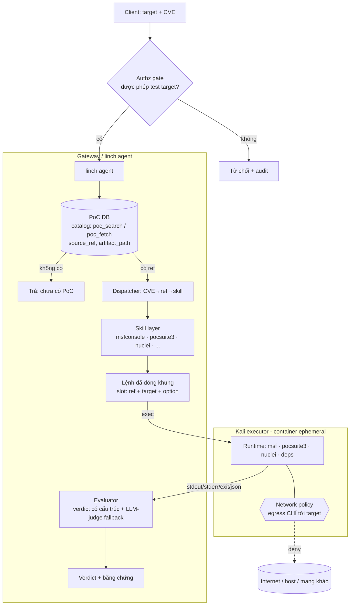

# Kiến trúc PoC-Verify: kiểm thử CVE trên target qua linch + Kali executor

> Trạng thái: **đề xuất**. Mở rộng hệ thống PoC hiện tại (read-only, search/fetch) thêm khả
> năng **thực thi PoC vào một target** để xác minh lỗ hổng — có kiểm soát, mặc định verify-only.

## 1. Mục tiêu & phạm vi

- **Input:** `target` + `CVE` (hoặc `ref` PoC).
- **Output:** verdict `vulnerable | not-vulnerable | inconclusive | error` + bằng chứng thô.
- **Nguyên tắc:** linch điều phối & sinh lệnh **qua skill** (không bịa lệnh tự do); Kali chỉ là
  **môi trường thực thi câm**; kết quả trả lại linch để đánh giá.
- **Phạm vi execute = nguồn map được vào một skill/tool có CLI ổn định.** Nguồn không map được
  (exploitdb .py rời, github tuỳ ý không load được) → dừng ở "hiển thị code", không chạy.

## 2. Sơ đồ luồng



## 3. Thành phần

| # | Thành phần | Vai trò | Ghi chú |
|---|---|---|---|
| 1 | **Authz gate** | Chặn target ngoài scope được phép | Bắt buộc trước mọi thực thi; audit |
| 2 | **linch agent** | Điều phối: tra DB → chọn skill → gọi executor → đánh giá | Tái dùng agent framework hiện có |
| 3 | **PoC DB (catalog)** | Tra CVE→PoC, trả `ref` có cấu trúc (`source_ref`, `artifact_path`) | Đã có: `poc_search`/`poc_fetch`/`prefetch_evidence` |
| 4 | **Dispatcher** | Map `CVE → ref → skill` theo `source` | Router mỏng; quyết định nguồn nào chạy được |
| 5 | **Skill layer** | Đóng khung invocation từng tool; LLM chỉ điền slot | `msfconsole`, `pocsuite3`, `nuclei`, (sau: `sqlmap`…) |
| 6 | **Kali executor** | Container ephemeral chạy lệnh, trả output thô | "Môi trường câm"; cô lập; huỷ sau mỗi run |
| 7 | **Evaluator** | Chuyển output → verdict | Ưu tiên verdict có cấu trúc; LLM-judge là fallback |
| 8 | **Audit/log** | Ghi mọi target/lệnh/kết quả | Truy vết + phát hiện lạm dụng |

## 4. Map nguồn → skill/tool → chế độ

| Nguồn (catalog) | Skill/tool | Lệnh (đóng khung) | Verdict | Mức |
|---|---|---|---|---|
| **nuclei** | nuclei | `nuclei -t <artifact_path> -u <target> -j` | JSON matched | ✅ turn-key |
| **metasploit** | msfconsole | `use <source_ref>; set RHOSTS <target>; check` | check state | ✅ turn-key |
| **pocsuite3 / github-loadable** | pocsuite3 | `pocsuite -r <poc> -u <target> --verify` | parse_output | ⚠️ cần PoC dạng POCBase |
| **exploitdb .py rời / github tuỳ ý** | — | (không có CLI ổn định) | — | ❌ ngoài scope execute |
| **ghsa / trickest** | — | metadata/link, không có artifact chạy | — | ❌ ngoài scope execute |
| **vulhub** | (target-side) | `docker compose up` để **dựng target lab** | — | ↔ bổ trợ, không phải PoC để bắn |

## 5. Ranh giới an toàn (bắt buộc — độc lập với skill)

Skill lo **"lệnh đúng"**, KHÔNG lo **"an toàn khi chạy"**. Vẫn phải có:

- **Isolation:** container ephemeral, non-root, rootfs read-only + tmpfs workdir, giới hạn
  CPU/mem/**timeout**, huỷ sau mỗi run.
- **Network:** egress **chỉ tới target**; deny host/internet/mạng khác (chặn pivot & exfil).
- **Mặc định verify-only.** `attack`/`shell` phải authz riêng (và cần session bền — giai đoạn sau).
- **Coi PoC code & output là hostile:** code chạy trong hộp; output do target chi phối → khi
  feed lại linch để đánh giá, prompt phải strict/structured (chống prompt-injection).
- **Audit** mọi lệnh; denylist thao tác phá hoại.

## 6. Đánh giá kết quả (Evaluator)

1. **Verdict có cấu trúc (ưu tiên):** nuclei `-j` (matched), msf `check` (state), pocsuite
   `parse_output` → tin cậy, không đoán mò.
2. **LLM-judge (fallback):** cho script — nạp `exit code + stdout + stderr + dấu hiệu kỳ vọng`;
   cảnh báo false positive/negative (script im lặng ≠ không dính).

## 7. Điểm chèn vào codebase — ĐÃ TRIỂN KHAI (Mode A, sau feature-flag)

Trạng thái: **đã nối vào `secai-agent-gateway`, tắt mặc định** (`verify_enabled=false`). Bật để thử,
tắt/gỡ khi không cần.

Đã thêm:
- `poc/runners/` — `docker_exec.py` (client `docker run` hardened §5) + `nuclei.py`/`msf.py`/`pocsuite.py`
  (dựng lệnh + parse verdict).
- `poc/verify.py` — `verify_poc(...)`: authz allowlist + resolve (cve|ref) → dispatch source→runner.
- `poc/tools.py` — tool `poc_verify(ref, target)` **chỉ tạo khi `verify_enabled`** (verify-only).
- `api/routes.py` — endpoint `POST /ai/verify` (404 khi tắt).
- `config.py` — `verify_enabled`, `kali_executor_image`, `verify_timeout_s/net/mem/cpus/pids`,
  `verify_allow_all`, `verify_allowed_targets`.
- `agent/runner.py` — truyền settings vào `build_poc_tools`; bỏ qua tool chưa tạo.
- `prompts/profiles.yaml` — thêm `poc_verify` vào `exploit_research`.
- `tests/test_verify.py` — flag gate + authz + endpoint (docker-free).

`LocalPocBackend` giữ nguyên read-only; toàn bộ đường thực thi nằm ở `poc/runners/` + `poc/verify.py`.

### Bật (connect thử)
```bash
export VERIFY_ENABLED=true
export VERIFY_ALLOWED_TARGETS="10.0.0.5,192.168.1.0/24"   # hoặc VERIFY_ALLOW_ALL=true (lab)
# image secai-kali-executor:latest phải có trên host; tiến trình gateway phải gọi được docker
```
```bash
curl -s localhost:8131/ai/verify -H 'content-type: application/json' \
  -d '{"target":"http://10.0.0.5:8080","cve":"CVE-2021-44228"}'
```

### Gỡ
- Nhanh: bỏ `VERIFY_ENABLED` (về false) → endpoint 404, tool biến mất. Không còn đường thực thi.
- Sạch: xoá `poc/runners/`, `poc/verify.py`, `tests/test_verify.py`; revert hunk nhỏ ở
  `config.py`, `agent/runner.py`, `poc/tools.py`, `api/routes.py`, `api/schemas.py`, `prompts/profiles.yaml`.

### Yêu cầu runtime (ops)
- Tiến trình gateway (systemd :8131) phải có quyền `docker` (nhóm `docker`/rootless).
- Egress "chỉ tới target" (§5) vẫn cần firewall host trên bridge của container.
- Runner mount **read-only** file artifact vào container: nuclei = template (`roots["nuclei"]/artifact_path`);
  metasploit không cần (dùng `source_ref`).

### Mở rộng: scoped tools + RAW exec (đã thêm)

**`POST /ai/tool`** — chạy tool pentest trong Kali với argv **do gateway dựng** từ tham số đã
validate (không raw tùy ý): `nmap` · `searchsploit` (offline) · `gobuster` · `sqlmap` · `hydra`.
Gated `verify_enabled`; tool cần target dùng chung authz allowlist. Runner: `poc/runners/toolbox.py`.
```bash
curl -s localhost:8131/ai/tool -d '{"tool":"nmap","target":"10.0.0.5","ports":"1-1000"}'
curl -s localhost:8131/ai/tool -d '{"tool":"searchsploit","query":"log4j"}'   # offline, không cần target
```

**`POST /ai/exec`** — ⚠️ **RAW/RCE có chủ đích**: chạy **lệnh bất kỳ** (kể cả tấn công) trong Kali
với `--privileged` + root (**KHÔNG sandbox**). Tắt mặc định (`exec_enabled=false`, 404 khi tắt) và
**luôn yêu cầu admin API key** (`X-API-Key == ADMIN_API_KEY`) để không thành RCE mở toang. Bật =
tin tưởng hoàn toàn caller đang giữ key.
```bash
export EXEC_ENABLED=true ADMIN_API_KEY=<key>       # exec_privileged=true mặc định
curl -s localhost:8131/ai/exec -H "X-API-Key: <key>" -d '{"shell":"nmap -sS -p- 10.0.0.5"}'
curl -s localhost:8131/ai/exec -H "X-API-Key: <key>" -d '{"cmd":["id"]}'
```
`exec_privileged=false` → chạy trong sandbox hardened thay vì privileged. Gỡ = bỏ `EXEC_ENABLED`.

**Cảnh báo:** `/ai/exec` biến gateway thành bàn đạp thực thi mã root tùy ý trong Kali. Chỉ bật trong
mạng tin cậy, sau reverse-proxy có TLS + xác thực, không phơi ra internet; mọi lệnh nên được audit.

### Agent tool — multi-turn: LLM tự gọi nmap/scan/exec trong lúc chạy

Ngoài HTTP `/ai/tool` + `/ai/exec` (con người/API caller gọi trực tiếp), 2 tool mới cho
`exploit_research` để **LLM tự chuỗi nhiều bước trong 1 phiên** (search → fetch → verify → scan →
exec, agent tự quyết bước tiếp theo dựa trên kết quả bước trước):

- **`poc_scan`** — LLM tự gọi `nmap/searchsploit/gobuster/sqlmap/hydra`. Gated `verify_enabled`.
- **`poc_exec`** — LLM tự chạy **lệnh bất kỳ, privileged**. Gated `exec_enabled`.

⚠️ **`poc_exec` làm agent tool KHÔNG đi qua cổng admin-API-key** của endpoint `/ai/exec` (agent
không gửi header) — bật `exec_enabled` nghĩa là **mọi người dùng cuối** gọi vào profile
`exploit_research` (gián tiếp qua hội thoại) có thể khiến model chạy lệnh root tùy ý. Chỉ bật ở
môi trường đã kiểm soát truy cập từ trước.

**Giới hạn multi-turn ở tầng container (không đổi):** mỗi lệnh vẫn `docker run --rm` — container
mới, huỷ ngay sau mỗi lệnh (ephemeral, đúng §5). LLM có thể gọi tool nhiều lượt (multi-turn ở tầng
agent), nhưng **không có session/state giữ giữa các lần gọi** (không phải 1 shell liên tục, không
phải msfconsole session còn sống qua nhiều lệnh) — file tạo ở lượt A không còn ở lượt B.

### Nhiều người dùng đồng thời — không nhầm/loạn kết quả

Mỗi lệnh là 1 `docker run --rm` biệt lập → không có container/state dùng chung giữa 2 user, nên
KHÔNG có đường trộn output ở tầng container. Kết quả trả về vẫn đúng luôn nhờ mô hình
request-per-coroutine của FastAPI/asyncio (biến cục bộ, không state toàn cục giữ "kết quả gần
nhất"). Ba cơ chế bổ sung để việc này rõ ràng khi vận hành, không chỉ "đúng về lý thuyết":

1. **Concurrency cap** (`verify_max_concurrent`, mặc định **16** — tính theo host hiện tại 96 vCPU,
   mỗi container cấp `--cpus 2` → 16 dùng tối đa 32 CPU, dư ~64 CPU cho host + service khác
   Qdrant/Neo4j/OpenVAS; trần lý thuyết của host là 48 = 96÷2, không khuyến nghị chạy sát trần vì
   còn cần headroom + tránh chính việc quá nhiều scan song song làm nghẽn/loạn kết quả phía
   target) — semaphore dùng chung toàn tiến trình chặn quá nhiều container chạy song song làm quá
   tải docker daemon/host khi nhiều người dùng gọi cùng lúc (khác rate limiter — đó là giới hạn
   *tốc độ theo từng client*, cái này giới hạn *số lệnh chạy đồng thời trên toàn hệ thống*). Vượt
   trần → chờ tới lượt, không rớt request. Đổi qua `VERIFY_MAX_CONCURRENT` nếu deploy trên phần
   cứng khác.
2. **Container naming theo run_id** — mỗi container có `--name secai-<run_id>-<random8>` để
   `docker ps`/log phân biệt request nào đang chạy container nào, kể cả khi 1 run_id gọi nhiều
   lệnh (multi-turn) hoặc nhiều run_id chạy đồng thời.
3. **Audit log cho MỌI đường gọi** — `/ai/verify`, `/ai/tool`, `/ai/exec` (gọi HTTP trực tiếp) và
   `poc_verify`/`poc_scan`/`poc_exec` (agent tool) đều ghi vào ledger: `user_id` (nếu caller cung
   cấp), target/tool/cve, verdict/rc. Đây là nguồn duy nhất phân xử "ai đã ra lệnh cho container
   nào, ra kết quả gì" khi có nhiều người dùng.

Test: `tests/test_docker_exec.py` (semaphore cap thật bằng subprocess giả lập, container naming,
run_id thread xuống tới argv `docker run`).

## 8. Không nằm trong phạm vi (giai đoạn 1)

- Auto-exploit / getshell / lateral movement.
- Session bền nhiều bước (msf `run`/`shell`).
- Chạy PoC không map được vào skill/tool.
